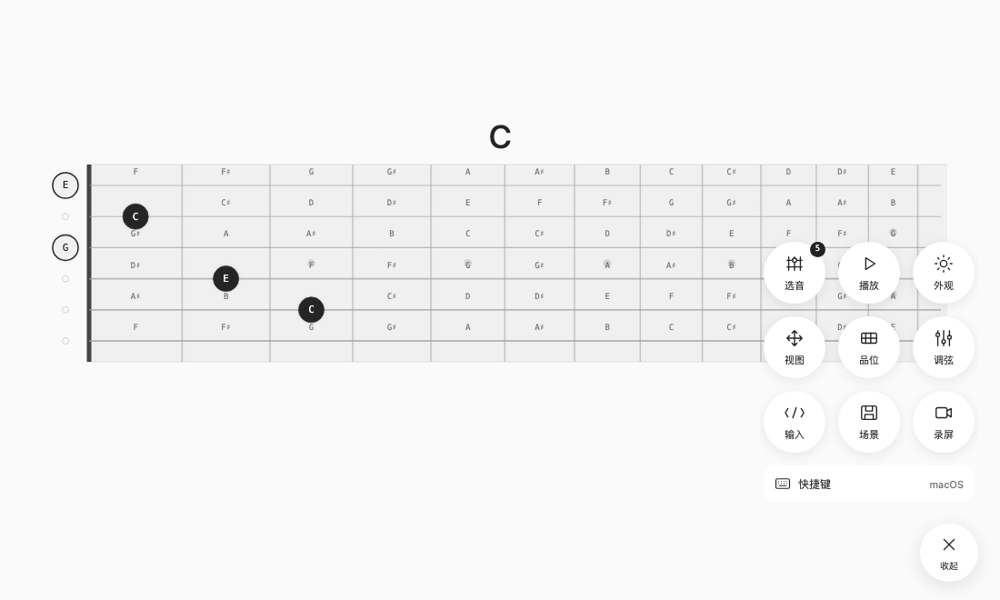
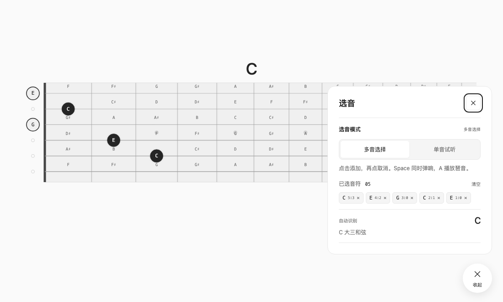
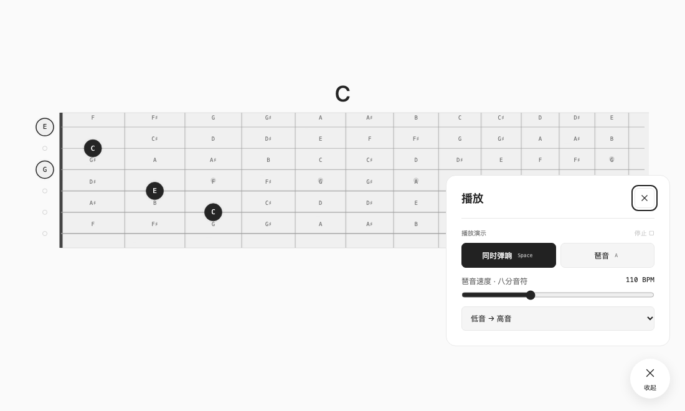
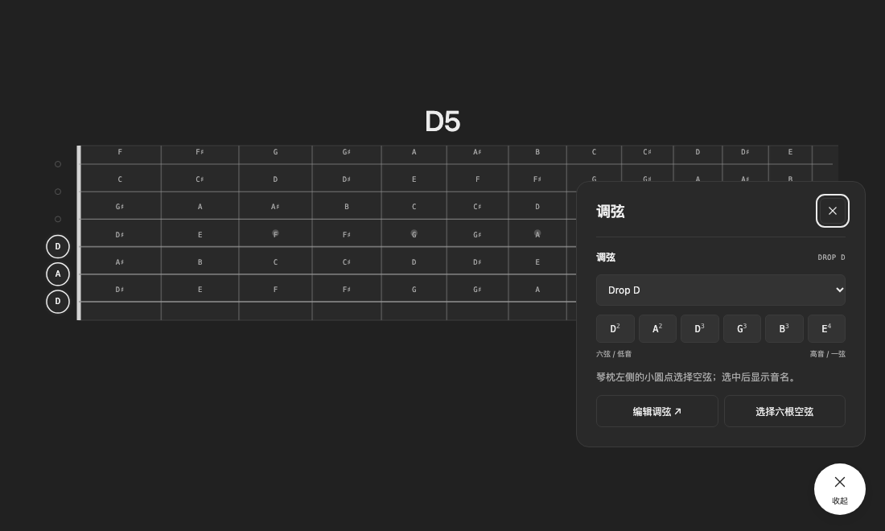
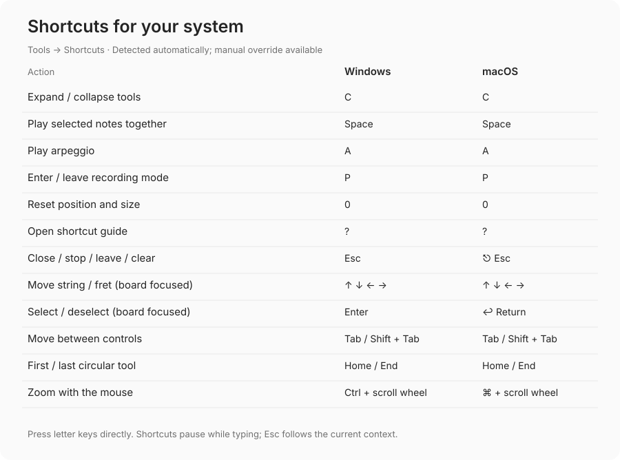

# Guitarfret-note

[简体中文](README.md) · **English**

A minimal guitar fretboard for exploring notes and chords, demonstrating fingerings, and preparing clean screen recordings. Built with vanilla JavaScript and Canvas. Open it in your browser; no account or installation required.

**[Use online](https://gsflaming.github.io/Guitarfret-note/)** · [Alternative address](https://fret-note-studio.gsflaming86.workers.dev/) · [Shortcut reference (Chinese)](docs/SHORTCUTS.md) · [Deployment guide (Chinese)](docs/DEPLOYMENT.md)

The fretboard is the main workspace. Use the white button at the bottom right to expand or collapse the tools. The current app interface is in Chinese; the English instructions below explain the controls shown in each screenshot.

## Features

- Six strings and 24 frets, including open strings, multiple-note selection, and single-note preview.
- Chord identification based on the current tuning, actual pitches, and lowest note, including common extensions and inversions. Unmatched combinations are shown as note names.
- Play selected notes together or as an eighth-note arpeggio, with adjustable tempo and order.
- Pan, zoom, focus on a fret range, follow-mouse tilt, and light or dark themes.
- Standard and alternative tunings, custom tuning, and input by string/fret or note name.
- Saved scenes and a clean recording mode that hides the tools.
- Automatic Windows/macOS detection for shortcut hints, with a manual override.

Recording mode only hides the interface; it does not record video. Sound uses browser-synthesized plucked strings, not recorded guitar samples. This release focuses on fretboard demonstrations and does not include PDF or AI score recognition.

## Illustrated quick start

Open the **Use online** link above. There is no need to download the source or start a development server. The screenshots show the current application with predefined note selections.

### Select notes and identify chords

Click the fretboard to select a note; click it again to remove it. The separate circles on the left select open strings. Strings run from string 1 at the top to string 6 at the bottom. Open **Tools → Note selection** (`工具 → 选音`) to see selected positions and the identified chord, or switch to single-note preview (`单音试听`).

Try the C major chord shown above: open **Tools → Input** (`工具 → 输入`), choose string/fret input (`弦 / 品`), enter `x 3 2 0 1 0`, and apply it. The six positions run from string 6 to string 1; `x` means muted and `0` means an open string. You can also enter `5:3 4:2 3:0 2:1 1:0`. Note-name input accepts `C E G`, or a pitch with an octave such as `E4`.

### Play chords and arpeggios

Press **Space** to play the selected notes together, or **A** to arpeggiate them. Open **Tools → Playback** (`工具 → 播放`) to change the tempo and order. The screenshot shows 110 BPM, low to high, with an eighth note between successive notes. Click **Stop** (`停止`) to interrupt playback.

### Change tuning and appearance

**Tools → Tuning** (`工具 → 调弦`) offers presets such as Standard and Drop D, as well as custom pitches with octave numbers. Note names, chord identification, and sound are recalculated for the new tuning. In the screenshot, Drop D lowers string 6 to D2. Tuning fields run from string 6 to string 1.

Switch light/dark themes in **Tools → Appearance** (`工具 → 外观`). This panel also controls note labels, chord names, sound, and the follow-mouse effect (`跟随鼠标`).

### Windows and macOS shortcuts

Expand the tools and choose **Shortcuts** (`快捷键`), or press **?**. The guide detects your system automatically; you can manually switch the displayed system if detection is incorrect. Windows shows **Ctrl + scroll wheel**, and Mac shows **⌘ + scroll wheel**. Trackpads support two-finger panning and pinch-to-zoom; touchscreens support two-finger gestures.

Press letter shortcuts directly, without Ctrl or ⌘. Typing, input-method composition, and system key combinations do not trigger playback. For focus navigation and the contextual behavior of Esc, see the [full shortcut reference (Chinese)](docs/SHORTCUTS.md).

### Other useful tools

| Tool | What it does |
| --- | --- |
| View / Frets (`视图 / 品位`) | Adjust position and size, reset the view, or focus on a fret range. |
| Scenes (`场景`) | Save selected notes, tuning, fret range, and view settings, then load them in the same browser. |
| Recording (`录屏`) | Press P to hide the tools and P again to restore them. Use your operating system's screen recorder to capture video. |

## Data and privacy

Notes, tuning, scenes, and interface settings are stored in the current browser's localStorage. They do not transfer automatically between browsers or domains. System detection runs locally. The app does not send scores, notes, or platform information to a server and does not call AI or other external APIs. The static hosting provider still handles normal web requests.

## Contributing

[Report a problem or suggest a feature](https://github.com/GSflaming/Guitarfret-note/issues). Contributions to music theory, interaction, accessibility, and documentation are welcome.

Before opening an Issue or Pull Request, read the [contribution guide (Chinese)](CONTRIBUTING.md). It explains the project scope, development environment, submission requirements, testing, and review process. To use the tool, simply open the online version.

For self-hosting, see the [deployment guide (Chinese)](docs/DEPLOYMENT.md). The code is licensed under [MIT](LICENSE).
