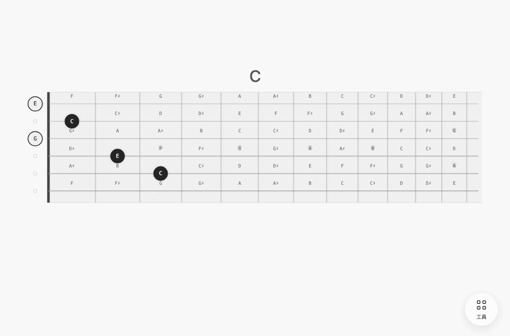
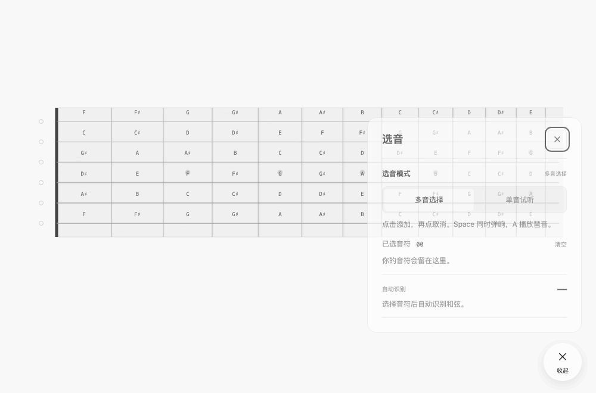
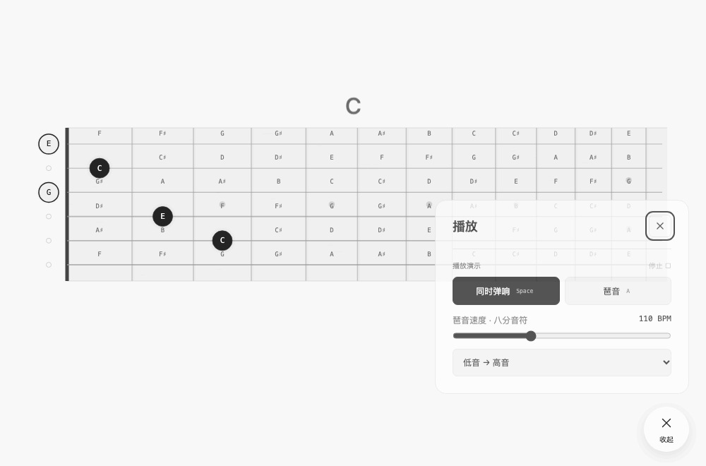
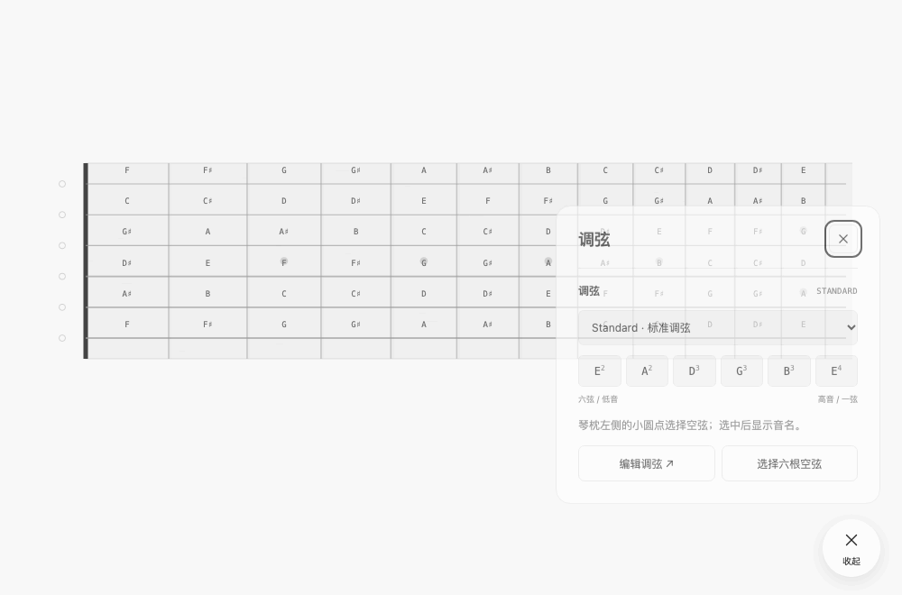
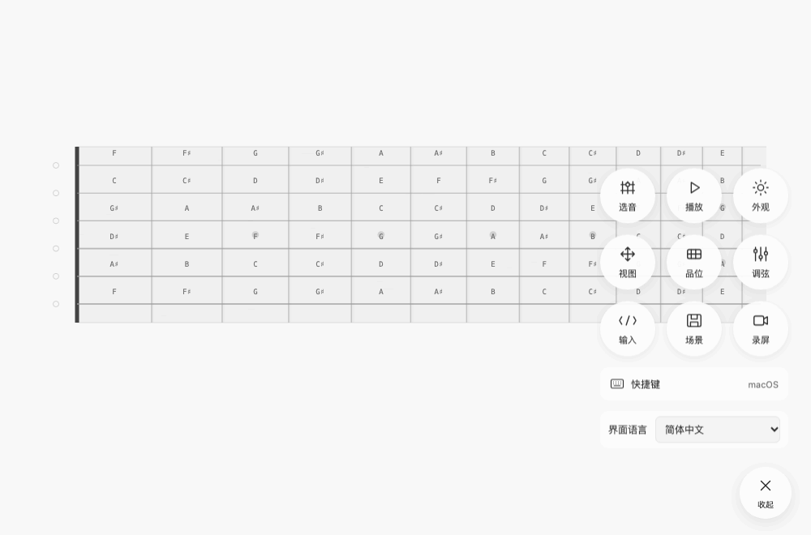

# Guitarfret-note

**简体中文** · [English](README.en.md)

一个简洁的吉他指板工具，用来探索音符与和弦、演示指法，以及制作干净的录屏画面。原生 JavaScript / Canvas，打开浏览器即可使用，无需注册或安装。

**[在线使用](https://gsflaming.github.io/Guitarfret-note/)** · [备用访问地址](https://fret-note-studio.gsflaming86.workers.dev/) · [快捷键表](docs/SHORTCUTS.md) · [部署说明](docs/DEPLOYMENT.md)

指板是主画面，右下角白色「工具」按钮可展开或收起功能。界面支持中文和英文，首次根据浏览器语言选择；在展开的菜单底部切换「界面语言」，设置会保留。

## 可以做什么

- 六弦、24 品指板；支持空弦、多音选择与单音试听。
- 根据调弦、实际音高与最低音识别和弦，包括常见延伸和弦与转位。无法匹配时显示音名。
- 同时弹响或按八分音符播放琶音，支持速度和顺序调整。
- 平移、缩放、品位取景、跟随鼠标，以及浅色／深色主题。
- 标准与多种开放调弦、自定义调弦；通过弦／品或音名输入音符。
- 保存场景；录屏模式隐藏工具，让指板保持干净。
- 中文／英文完整界面，可自动选择或手动切换；Windows／macOS 快捷键提示分别适配。

录屏模式仅隐藏工具，不会自行录制视频。声音由浏览器合成拨弦，并非吉他采样。当前版本专注指板演示，不包含 PDF／AI 识谱。

## 看图上手

直接打开上方「在线使用」链接即可，无需下载代码或启动开发服务。以下 GIF 直接录制当前界面的实际变化，使用固定示例；GIF 不包含声音。

### 选音与和弦识别

点击指板添加音符，再点一次取消；左侧独立圆点选择空弦。图上从上到下为一弦至六弦。在「工具 → 选音」中可以查看已选位置、和弦名称，或切换为「单音试听」。

试一试图中的 C 大三和弦：打开「工具 → 输入」，选择「弦 / 品」，输入 `x 3 2 0 1 0` 后应用。六个位置从六弦排到一弦，`x` 表示不演奏，`0` 表示空弦。也可输入 `5:3 4:2 3:0 2:1 1:0`；音名输入支持 `C E G` 或带八度的 `E4`。

### 同时弹响与琶音

选好音符后按空格同时弹响，按 A 播放琶音。打开「工具 → 播放」可调整速度和顺序；演示为 110 BPM、从低音到高音，每两个音相隔八分音符。播放时可点「停止」中断。

### 调弦与主题

「工具 → 调弦」提供标准调弦、Drop D 等预设，也支持自定义带八度的音高。切换后，音名、和弦和声音都会按新调弦计算。演示中 Drop D 将六弦降低到 D2，调弦面板按六弦至一弦排列。

浅色／深色主题在「工具 → 外观」切换。同一面板还可设置音名、和弦名、声音与「跟随鼠标」。

### Windows 与 macOS 快捷键

展开工具后点击「快捷键」，或按 `?` 打开快捷键表。系统自动识别，浏览器识别不准时也可手动切换。Windows 提示 Ctrl + 滚轮，Mac 提示 ⌘ + 滚轮；触摸板可双指平移和捏合缩放，触屏支持双指操作。

字母快捷键直接按，不需要 Ctrl 或 ⌘。输入文字、输入法组合输入和系统组合键不会触发播放。更多焦点与 Esc 说明见[完整快捷键表](docs/SHORTCUTS.md)。

### 其他常用工具

| 工具 | 用法 |
| --- | --- |
| 视图／品位 | 调整大小与位置、复位，或聚焦到指定品位范围 |
| 场景 | 保存当前选音、调弦、品位和视图，之后在同一浏览器载入 |
| 录屏 | 按 P 隐藏工具，再按 P 恢复；实际视频使用系统录屏功能录制 |

## 数据与隐私

音符、调弦、场景与界面设置仅保存在当前浏览器的 localStorage；更换浏览器或域名不会自动迁移。设备系统检测在本机完成，应用不发送乐谱、音符或平台信息，不调用 AI 或其他外部 API。静态托管平台仍会处理正常网页请求。

## 参与贡献

欢迎[反馈问题或提出建议](https://github.com/GSflaming/Guitarfret-note/issues)，也欢迎改进音乐理论、交互、无障碍体验和文档。

提交 Issue 或 Pull Request 前，请阅读[中文贡献指南](CONTRIBUTING.md)或[English contributing guide](CONTRIBUTING.en.md)。其中说明了项目范围、开发环境、提交要求、测试方法与审核流程。普通用户直接使用在线工具即可。

需要自己部署时，请参考[部署说明](docs/DEPLOYMENT.md)。代码采用 [MIT](LICENSE) 许可证。
